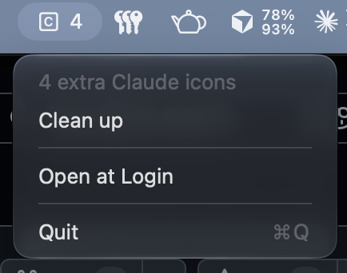

# Unghost

A tiny macOS menu bar app that clears the extra Claude icons a subagent swarm leaves in the Dock.

The pinned Claude icon stays. This app has no Dock icon of its own. No settings window, no network access, no dependencies. One Swift file.



## Features

- Menu bar icon shows how many Claude Dock icons are stuck past the first one
- Clean up drops the duplicate recent-app entries, then restarts the Dock so the ghost tiles go away
- The pinned Claude icon is left where it is
- Open at Login toggle in the menu

## Install

### Homebrew

```
brew install andrecamm/tap/unghost
```

Homebrew puts `Unghost.app` in your Applications folder and clears the quarantine flag, so it opens without a Gatekeeper prompt. Run `brew upgrade` to update it.

### Download

1. Grab `Unghost.zip` from the [latest release](https://github.com/AndreCamm/Unghost/releases/latest) and unzip it.
2. Move `Unghost.app` to your Applications folder.
3. Open it. The app isn't notarised by Apple, so the first time macOS will block it. Go to **System Settings, Privacy & Security**, scroll down and click **Open Anyway**. Alternatively, run:

   ```
   xattr -dr com.apple.quarantine /Applications/Unghost.app
   ```

### Build from source

You need Xcode or the Command Line Tools (`xcode-select --install`).

```
git clone https://github.com/AndreCamm/Unghost.git
cd Unghost
./build.sh
cp -r build/Unghost.app /Applications/
open /Applications/Unghost.app
```

Apps you build yourself aren't quarantined, so there's no Gatekeeper prompt.

## Using it

Click the **C** in the menu bar, then **Clean up**. The Dock disappears for a moment and comes back with one Claude icon.

**The number.** It is the count of Claude icons after the first one. That count needs Accessibility access. Cleanup works without it. The first time, choose **Allow Dock counting…** and turn the app on under System Settings, Privacy & Security, Accessibility. If the switch is already on and the menu still says access is off, turn it off and on again, then choose **Relaunch to apply access**. macOS ties that permission to the app's signature, and a rebuild changes an ad-hoc signature.

**Open at login.** Click the item and tick **Open at Login** (macOS 13 or later).

**Quit.** Click the item and choose Quit.

## Why the icons appear

Agents in Claude and T3 Code launch `chrome-headless-shell`, the headless browser behind Playwright and T3's browser tool. That program has no app bundle. Launch Services files it, and every helper process it starts, under the app that launched it (Claude, T3 Code, Ghostty, Cursor).

The browser process registers as a UI element. Its audio and video capture helpers register too. On macOS 27 the Dock inserts a tile as soon as a second process registers under the parent, whatever type that process declares, and about half of those tiles are never removed. Each browser launch therefore leaves a "T3 Code" or "Claude" tile behind. An agent that opens a browser every few seconds fills the Dock in minutes.

The tiles are not part of the saved Dock layout. Clean up deletes the duplicate recent-app entries, then restarts the Dock with `killall -9` so it cannot save them on the way down.

Cleaning up does not stop the next swarm. The guard does.

## Stop the tiles coming back

A process with no Launch Services record cannot get a Dock tile. `guard/patch.py` renames each `chrome-headless-shell` to `chrome-headless-shell.real` and puts a small stand-in in its place. The stand-in loads `guard/chsguard.c` into the browser and runs the real binary with the same arguments. Inside every chrome child process (anything started with `--type=`) the library skips the Launch Services check-in. The browser process itself is left alone.

Changing the process type (UI element, background only) does not work. The Dock inserts the tile before it looks at the type.

Camera, microphone and audio output inside the browser do not depend on the registration. They were tested with `getUserMedia` and `AudioContext` before and after the change, with the same result.

```
git clone https://github.com/AndreCamm/Unghost.git
python3 Unghost/guard/patch.py --install
```

If you already cloned the repository to build the app, run `guard/patch.py --install` from that clone instead. Keep the folder after you install the guard. The login item runs `patch.py` from it. If you move the folder, run `--install` again from the new place.

A login item wraps any new browser download under `~/.t3/tools` and `~/Library/Caches/ms-playwright`. The guard does not modify Claude Code or Codex. Loading a library into those binaries crashes Bun at startup. A browser that was already open when the guard was installed keeps its tiles until it exits.

The proper fix belongs upstream: ship the headless shell inside a helper app bundle with `LSUIElement`, as every desktop Chromium build does, or disclaim responsibility for it when spawning.

## Requirements

- macOS 13 Ventura or later

## Contributing

Issues and pull requests are welcome. The whole app lives in [`Sources/Unghost.swift`](Sources/Unghost.swift), and the aim is to keep it small and single purpose.

## Releasing

Push a tag such as `v1.4.0`. The Build workflow then:

1. Builds the universal app with that version.
2. Signs and notarises it, when the Developer ID secrets are set.
3. Publishes `Unghost.zip` to a GitHub release.
4. Updates the cask in [AndreCamm/homebrew-tap](https://github.com/AndreCamm/homebrew-tap), when `HOMEBREW_TAP_TOKEN` is set.

| Secret | What it is |
|---|---|
| `DEVELOPER_ID_P12` | The Developer ID Application certificate and key, exported as `.p12` and base64 encoded |
| `DEVELOPER_ID_P12_PASSWORD` | The password of that `.p12` |
| `NOTARY_KEY` | The contents of an App Store Connect API key (`.p8`) |
| `NOTARY_KEY_ID` | The ID of that key |
| `NOTARY_ISSUER_ID` | The issuer ID shown with App Store Connect API keys |
| `HOMEBREW_TAP_TOKEN` | A fine-grained token with write access to the contents of `homebrew-tap` only |

## License

[MIT](LICENSE)
